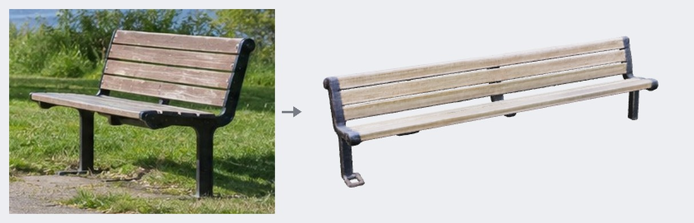
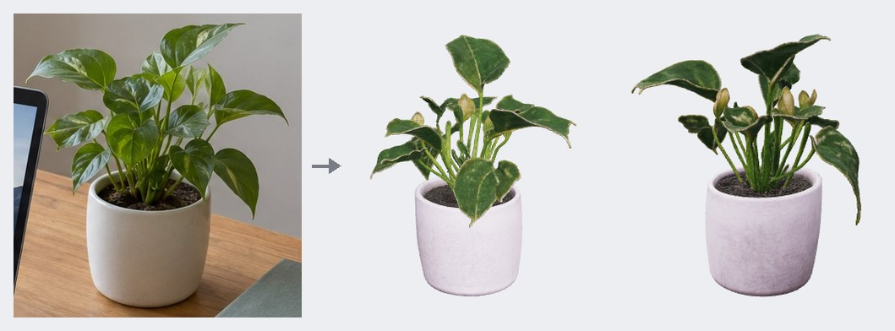
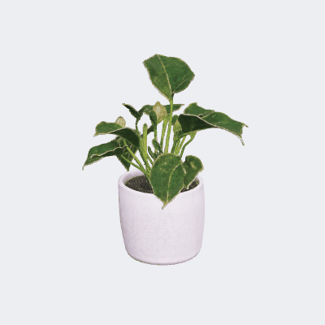
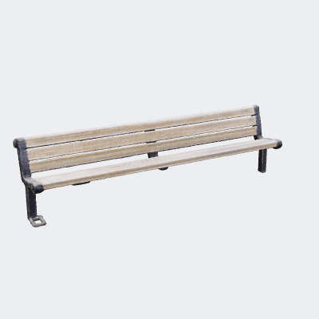

# TRELLIS.2 — 이미지 → 재질 입힌 3D

PromBoard 커뮤니티 플러그인입니다. 캔버스에 **TRELLIS.2 이미지 → 3D** 노드 하나를 더합니다. 물체 사진 한 장을 넣으면 색 · 거칠기 · 금속성 · 투명도 재질(PBR)이 입혀진 3D 모델을 GLB 파일로 만듭니다. Microsoft [TRELLIS.2](https://github.com/microsoft/TRELLIS.2)(4B)를 C++ 로 옮긴 [trellis.cpp](https://github.com/pwilkin/trellis.cpp)로 돌려서, 파이썬 패키지 · CUDA 컴파일 없이 윈도우에서 돕니다.



왼쪽이 넣은 사진, 오른쪽이 결과 GLB 를 PromBoard 앱과 같은 three.js(GLTFLoader)로 그린 그림입니다.

## 결과 예시

모두 이 저장소의 `nodes/main.py` 를 PromBoard 앱(격리 실행)에서 그대로 돌린 결과입니다(1.0.0). 판 TRELLIS.2 · 경량화 GGUF Q4, 엔진 CUDA 13, 해상도 1024, 시드 42.



 

- 화분: 잎 · 줄기 · 흙 · 화분 재질까지 사진과 거의 같게 나옵니다. 사진에 안 보이는 뒤쪽 잎도 그럴듯하게 채웁니다.
- 벤치: 모양 · 나뭇결은 잘 나오지만 **사진보다 의자가 길게 나왔습니다.** 비스듬히 찍힌 사진에서 깊이를 잘못 짐작한 결과입니다. 물체가 정면이나 조금 비스듬히 크게 나온 사진이 잘 됩니다.

## 받는 것 · 크기

| 고르는 것 | 받는 크기 |
|---|---|
| 경량화 GGUF Q4 (그래픽카드 메모리 16GB 미만의 자동) | 6.5GB |
| 경량화 GGUF Q8 | 10.0GB |
| 경량화 원본 (f16, 16GB 이상의 자동) | 16.5GB |
| 판 Pixal3D · f16 | 14.5GB |
| 엔진 NVIDIA (CUDA 13, 기본) | 0.7GB |
| 엔진 NVIDIA (CUDA 12) | 0.6GB |
| 엔진 AMD · 인텔 (Vulkan) | 14MB |

고른 판 · 엔진만 받습니다. 경량화 '자동'은 이 PC 그래픽카드 메모리가 16GB 이상이면 원본(f16), 그 밖에는 GGUF Q4 를 고릅니다(16GB 는 trellis.cpp 문서의 '1024 해상도가 16GB 카드에서 돈다'를 따른 값입니다). Pixal3D 는 f16 하나뿐이라 경량화를 보지 않지만, 앱이 받을 파일을 설정 하나로만 고를 수 있어 경량화에서 고른 TRELLIS.2 파일도 함께 받습니다(GGUF Q4 6.5GB · Q8 10.0GB · 원본이면 12.9GB 더). Pixal3D 만 쓰려면 경량화를 GGUF Q4 로 두면 가장 적게 받습니다. 가중치는 Hugging Face [ilintar/trellis2-gguf](https://huggingface.co/ilintar/trellis2-gguf) · [vegax87/Pixal3D](https://huggingface.co/vegax87/Pixal3D), 실행 파일은 [trellis.cpp v0.8.1 릴리스](https://github.com/pwilkin/trellis.cpp/releases/tag/v0.8.1)에서 sha256 을 확인하며 받습니다. 플러그인 zip 에는 들어 있지 않습니다.

필요 그래픽카드 메모리: GGUF Q4 4GB(아래 실측 최대 3.4GB) · GGUF Q8 8GB(어림값 — Q4 실측에 Q8 이 더 받는 가중치 3.5GB 를 다 더한 값) · 원본 f16 16GB(trellis.cpp 문서).

## 그래픽카드 메모리 · 걸린 시간 (실측)

RTX 4070 SUPER 12GB · Windows 11, 경량화 GGUF Q4 · 엔진 CUDA 13 · 해상도 1024:

| 사진 | 그래픽카드 메모리 최대 | 걸린 시간 | GLB |
|---|---|---|---|
| 화분 (350×370) | 3.4GB | 10분 11초 | 13.6MB |
| 벤치 (310×240) | 기록 못 함 | 9분 30초 | 11.8MB |

- 시간은 디스크가 아주 바쁜 상태(다른 작업이 같은 하드디스크를 함께 쓰던 때)에서 잰 값입니다. 단계마다 가중치를 디스크에서 읽고, 마지막 GLB 쓰기(UV 펼치기 · 재질 굽기)가 CPU 로 3~4분 걸렸습니다. 보통 SSD 에서는 이보다 빠릅니다.
- 처음 실행 때는 받은 실행 파일 묶음을 플러그인 캐시 폴더에 한 번 풉니다(CUDA 판 0.7GB).
- **미검증**: 경량화 GGUF Q8 · 원본(f16), Pixal3D 판, CUDA 12 · Vulkan 엔진, 해상도 512 · 1536. 12GB 그래픽카드에서 GGUF Q4 만 돌려 보았습니다. 1.1.0 은 1.0.0 에서 판 고르기를 '판(TRELLIS.2 · Pixal3D)'과 '경량화'로 나눈 것이라 다시 돌려 보지 않았습니다.

## 알아 둘 것

- **윈도우 전용**입니다. trellis.cpp 의 리눅스 실행 파일도 있지만 시험하지 않아 넣지 않았고, 맥 판은 없습니다.
- trellis.cpp 릴리스의 실행 파일(trellis-cli, sha256 고정)을 받아 실행합니다. 앱이 플러그인에 거는 인터넷 차단은 이 실행 파일에는 걸리지 않습니다.
- CUDA 13 엔진은 NVIDIA 드라이버 580 이상이 있어야 합니다. 그보다 옛 드라이버는 CUDA 12 엔진(527.41 이상)을 고릅니다.
- 배경은 투명 PNG 면 그 투명도를 쓰고, 아니면 trellis.cpp 가 BiRefNet 으로 지웁니다.
- 면 수는 trellis.cpp 기본을 따릅니다(해상도 512 → 15만, 1024 이상 → 30만, quadric 줄이기). 면 수를 정하는 옵션이 trellis.cpp 에 없습니다.
- 결과 GLB 의 재질 그림은 WebP(`EXT_texture_webp`)입니다. PromBoard 3D 보기 · three.js 는 읽습니다. WebP 재질을 못 읽는 3D 프로그램도 있습니다.
- '재질 입히기'를 끄면 모양(메시)만 만들어 더 빠릅니다.

## 라이선스

플러그인 코드는 Apache-2.0([LICENSE](LICENSE), [NOTICE](NOTICE))입니다. 받는 것들의 라이선스:

- trellis.cpp(실행 파일) · TRELLIS.2 · Pixal3D · BiRefNet: MIT
- 그림 인코더 DINOv3(`dinov3.gguf`): [DINOv3 License](https://github.com/facebookresearch/dinov3/blob/main/LICENSE.md) — 상업 이용은 되지만 무역 제재 대상과 군사 · 무기 · 첩보 용도는 금지되고, 다시 나눠 줄 때 약관 사본을 함께 줘야 합니다.
- Pixal3D 판: 코드 · 가중치 모두 MIT 지만 원본 저장소(TencentARC/Pixal3D)가 EU 접속을 막아 두었고, 상업 · 지역 이용을 묻는 [이슈 #33](https://github.com/TencentARC/Pixal3D/issues/33)에 아직 답이 없습니다.

앱은 설치 때 이 조건을 보여 주고 확인을 받습니다.

## 설치

1. PromBoard → 플러그인 매니저 → **커뮤니티 플러그인** → 둘러보기에서 설치합니다.
2. 코드가 든 플러그인이라 **제한 모드**를 끄고 플러그인을 켭니다.
3. 처음 실행 전 실행 준비가 고른 판의 가중치와 실행 파일을 받습니다(그래픽카드 메모리 16GB 미만 7.2GB, 이상 17.2GB).
4. 캔버스 빈 곳을 오른쪽 클릭하면 메뉴 맨 아래 플러그인 묶음에 **TRELLIS.2 이미지 → 3D** 가 있습니다.

## 플러그인 만드는 사람을 위한 메모

```
manifest.json           플러그인 정보 · 노드(layout single, views orbit3d) · 경량화 · 판 · 엔진별 모델(requires.models[].when)
nodes/main.py           NODES = {"image-to-3d": 함수} — zip 풀기(폴더 밖 항목 거절), trellis-cli 를 셸 없이 인자 목록으로 실행,
                        표준 출력의 [n/7] 단계 줄로 진행률, 취소하면 프로세스 종료, 메모리 부족 글 알아보기
nodes/requirements-win.txt   파이썬 패키지 잠금 파일(Pillow 하나, torch 없음)
docs/                   이 README 의 그림 · 만드는 스크립트. 플러그인 zip 에는 넣지 않는다(.gitattributes export-ignore)
```

- 레지스트리는 zip 안 실행 파일(.exe · .dll)을 막으므로, 실행 파일 zip 은 `requires.models` 의 `url` 모델(GitHub 릴리스 주소 · sha256 고정)로 받고 노드가 처음 실행 때 플러그인 캐시 폴더에 풉니다.
- README 그림 다시 만들기: `python docs/scripts/render3d.py <model.glb> <이름> --still-az 0` 으로 정지 그림 · 한 바퀴 GIF(36장)를 만들고, `python docs/scripts/compose.py <출력.jpg> 360 <입력 사진> <렌더 그림...>` 으로 나란히 붙입니다. three.js 는 `THREE_DIR`(node_modules/three) 가 있으면 그것을, 없으면 unpkg 의 three@0.185.1 을 씁니다. Python 패키지 playwright · Pillow 가 필요합니다.
- 시험 사진(벤치 · 화분)은 PromBoard 가 만든 예제 사진(GPT Image)을 잘라 쓴 것입니다.

---

## English

A PromBoard community plugin. It adds one **TRELLIS.2 image → 3D** node to the canvas: give it one photo of an object and it writes a 3D model (GLB) with PBR materials (base color, roughness, metallic, opacity). It runs Microsoft [TRELLIS.2](https://github.com/microsoft/TRELLIS.2) (4B) through [trellis.cpp](https://github.com/pwilkin/trellis.cpp), a C++/GGML port, so it works on Windows without Python packages or CUDA compilation.


Left is the input photo, right is the result GLB drawn with three.js (GLTFLoader), the same loader the PromBoard app uses.

### Examples

All results come from running this repository's `nodes/main.py` (1.0.0) inside the PromBoard app (isolated run). Model TRELLIS.2 · quantization GGUF Q4, engine CUDA 13, resolution 1024, seed 42.


 

- Plant: leaves, stems, soil and the pot material come out very close to the photo, and the hidden back is filled in plausibly.
- Bench: shape and wood grain are good, but **the bench came out longer than in the photo** — the model misjudged depth from the angled shot. Photos with the object large and facing the camera (or slightly turned) work best.

### Downloads

| Choice | Size |
|---|---|
| Quantization GGUF Q4 (auto below 16 GB of GPU memory) | 6.5 GB |
| Quantization GGUF Q8 | 10.0 GB |
| Quantization original (f16, auto at 16 GB and above) | 16.5 GB |
| Model Pixal3D · f16 | 14.5 GB |
| Engine NVIDIA (CUDA 13, default) | 0.7 GB |
| Engine NVIDIA (CUDA 12) | 0.6 GB |
| Engine AMD · Intel (Vulkan) | 14 MB |

With quantization on auto (경량화 · 자동) the app picks the original f16 weights when the GPU has 16 GB or more and GGUF Q4 otherwise (16 GB follows the trellis.cpp docs: the 1024 cascade runs on a 16 GB card). Pixal3D has only f16 and ignores the quantization choice, but the app picks files to download from one setting at a time, so it also downloads the TRELLIS.2 files of the chosen quantization (GGUF Q4 6.5 GB, Q8 10.0 GB, or 12.9 GB more with the original). If you only use Pixal3D, set quantization to GGUF Q4 to download the least. Only the chosen model and engine are downloaded, pinned by sha256: weights from Hugging Face ([ilintar/trellis2-gguf](https://huggingface.co/ilintar/trellis2-gguf), [vegax87/Pixal3D](https://huggingface.co/vegax87/Pixal3D)) and the executables from the [trellis.cpp v0.8.1 release](https://github.com/pwilkin/trellis.cpp/releases/tag/v0.8.1). None of them are in the plugin zip.

GPU memory needed: GGUF Q4 4 GB (3.4 GB peak measured below), GGUF Q8 8 GB (estimate: the Q4 measurement plus all 3.5 GB of extra Q8 weights), original f16 16 GB (trellis.cpp docs).

### GPU memory and time (measured)

RTX 4070 SUPER 12 GB · Windows 11, GGUF Q4 · CUDA 13 · resolution 1024: peak GPU memory 3.4 GB; 10 min 11 s for the plant (13.6 MB GLB) and 9 min 30 s for the bench (11.8 MB GLB, memory not recorded). Times were measured while other jobs were hammering the same hard disk: each stage reads its weights from disk, and the final GLB write (UV unwrap and texture bake on the CPU) took 3–4 minutes. A normal SSD is faster. The first run also unpacks the engine bundle into the plugin cache once (0.7 GB for CUDA). **Not verified**: GGUF Q8, original f16 and Pixal3D, the CUDA 12 and Vulkan engines, resolutions 512 and 1536 — only GGUF Q4 was run, on a 12 GB card. 1.1.0 only splits the 1.0.0 model choice into a model (TRELLIS.2 · Pixal3D) and a quantization setting and was not re-run.

### Notes

- **Windows only.** trellis.cpp also ships Linux binaries, but they were not tested so they are not wired in; there is no macOS build.
- The plugin downloads and runs the executable from the trellis.cpp release (trellis-cli, pinned by sha256). The internet block the app puts on plugins does not apply to this executable.
- The CUDA 13 engine needs NVIDIA driver 580 or newer; older drivers should pick the CUDA 12 engine (527.41 or newer).
- A transparent PNG keeps its alpha; otherwise trellis.cpp removes the background with BiRefNet.
- Face count follows the trellis.cpp default (150K at resolution 512, 300K at 1024 and above, quadric simplification); trellis.cpp has no face-count option.
- The GLB textures are WebP (`EXT_texture_webp`). PromBoard's 3D view and three.js read them; some 3D programs do not.
- Turning off "재질 입히기" (texture) makes geometry only, faster.
- **Install**: PromBoard → Plugin Manager → **Community plugins** → Browse → install, turn off **Restricted mode** and enable the plugin. The first prepare downloads the chosen model and engine (7.2 GB below 16 GB of GPU memory, 17.2 GB at 16 GB and above). Right-click an empty spot on the canvas: the node is in the plugin group at the bottom of the menu.

The plugin texts in the app are Korean only for now — the plugin manifest takes a single language.

### License

Plugin code: Apache-2.0 ([LICENSE](LICENSE), [NOTICE](NOTICE)). trellis.cpp, TRELLIS.2, Pixal3D and BiRefNet are MIT. The image encoder DINOv3 (`dinov3.gguf`) is under the [DINOv3 License](https://github.com/facebookresearch/dinov3/blob/main/LICENSE.md): commercial use is allowed, but sanctioned parties and military, weapons and espionage uses are excluded, and redistribution must include a copy of the license. Pixal3D code and weights are MIT, but the original repository (TencentARC/Pixal3D) blocks EU access and [issue #33](https://github.com/TencentARC/Pixal3D/issues/33) asking about commercial and regional use is unanswered. The app shows these conditions and asks for confirmation at install time.
